# Manuel utilisateur — Carnet de tir

Bienvenue dans le manuel de **Carnet de tir**, l'application dédiée aux pratiquants du tir à l'arbalète Field.

Ce document explique comment utiliser chaque fonctionnalité. Pour l'installation de l'application, consulter le [README](README.md).

---

## Sommaire

1. [Premiers pas](#1-premiers-pas)
2. [Réglages d'arme](#2-réglages-darme)
3. [Groupements de flèches](#3-groupements-de-flèches)
4. [Entraînement et cible interactive](#4-entraînement-et-cible-interactive)
5. [Résultats de matchs](#5-résultats-de-matchs)
6. [Match play](#6-match-play)
7. [Chronomètre](#7-chronomètre)
8. [Statistiques](#8-statistiques)
9. [Licence FFTir](#9-licence-fftir)
10. [Calendrier et rappels](#10-calendrier-et-rappels)
11. [Paramètres](#11-paramètres)
12. [Signaler un problème](#12-signaler-un-problème)

---

## 1. Premiers pas

### Lancer l'application

Lors de la première ouverture, la page **Tireurs** s'affiche et indique qu'aucun tireur n'a encore été ajouté.

<table align="center">
  <tr>
    <td align="center">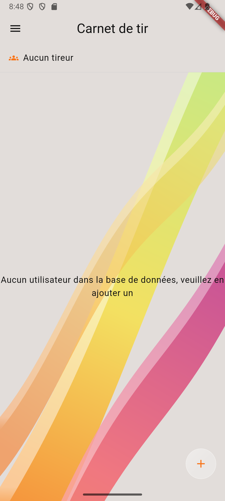 Liste des tireurs vide</td>
    <td align="center">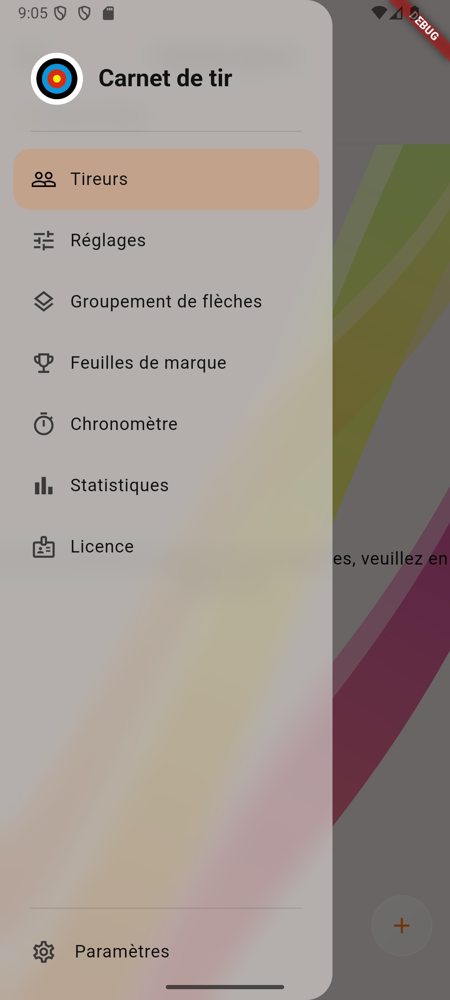 Tiroir de navigation</td>
  </tr>
</table>

Pour passer d'un onglet à l'autre, utiliser le bouton situé en haut à gauche, qui ouvre un tiroir de navigation.

### Ajouter un tireur

La plupart des données de l'application étant liées à un tireur, il est conseillé d'en ajouter un dès le début à l'aide du bouton `+` situé en bas à droite. Il faut ensuite renseigner au minimum un prénom, et éventuellement un nom. Le tireur est alors enregistré et apparaît dans la liste.

<table align="center">
  <tr>
    <td align="center">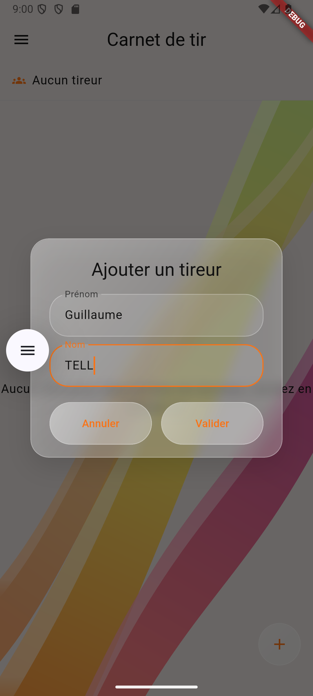 Ajout d'un tireur</td>
    <td align="center">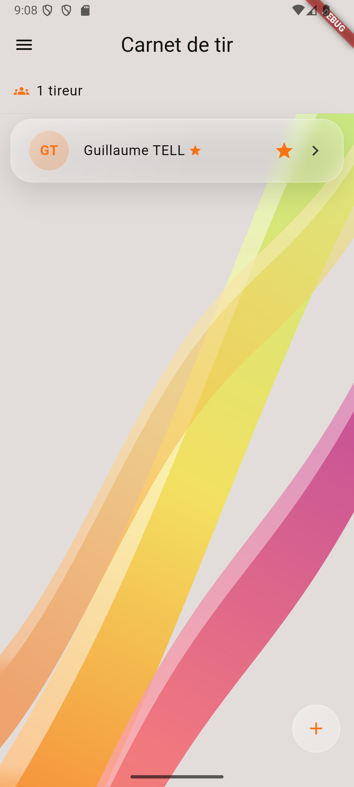 Tireur ajouté à la liste</td>
  </tr>
</table>

> [!NOTE]
> Le nombre de tireurs n'est pas limité.

> [!TIP]
> Un tireur peut être défini comme favori en appuyant sur l'étoile à côté de son nom. Il apparaît alors en priorité dans les menus déroulants des autres onglets.

### Sauvegarder ses données

> [!IMPORTANT]
> Il est conseillé d'exporter régulièrement ses données, ou d'activer la synchronisation automatique, afin de ne rien perdre en cas de changement de téléphone ou de réinstallation. Voir [Gestion des données](#gestion-des-données).

[↑ Retour au sommaire](#sommaire)

---

## 2. Réglages d'arme

Cette section permet de noter les réglages d'une arme selon l'arc utilisé et la distance de tir.

### Ajouter une arbalète et un arc

#### Ajouter une arbalète

Pour ajouter une arbalète, appuyer sur le bouton `+` en bas à droite de l'écran des réglages, puis renseigner un nom, une couleur et un type d'arbalète parmi les suivants :

- **Standard** : arbalète dotée d'un arbrier fixe ;
- **Arbrier variable**.

Dans le cas d'un arbrier variable, un réglage supplémentaire dédié est ajouté par défaut.

Les informations d'une arbalète peuvent être modifiées à l'aide du stylo situé en haut à droite de sa carte.

<table align="center">
  <tr>
    <td align="center"> Aucune arbalète</td>
    <td align="center">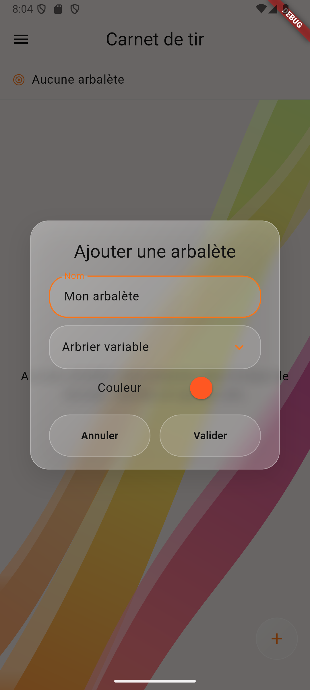 Ajout d'une arbalète</td>
    <td align="center">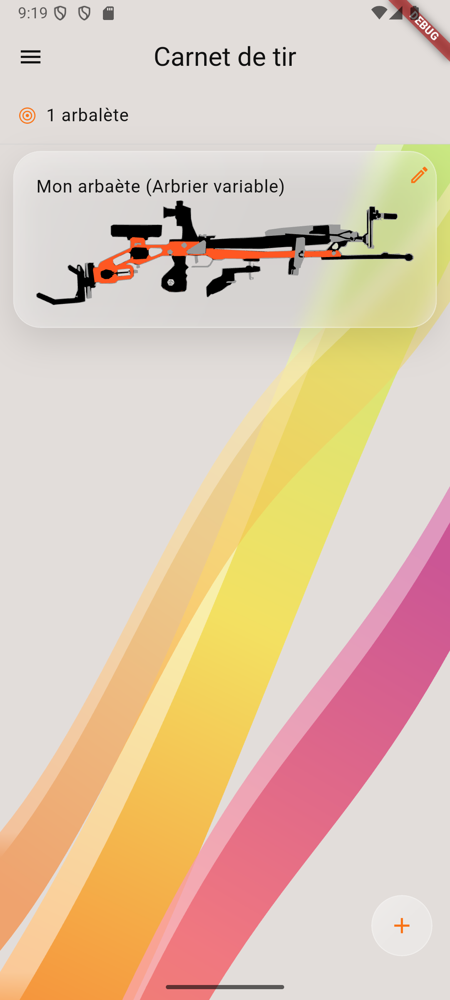 Arbalète ajoutée</td>
  </tr>
</table>

#### Ajouter un arc

Pour ajouter un arc, appuyer sur la carte de l'arbalète concernée. Une page apparaît alors, avec des réglages généraux et une liste d'arcs vide. Utiliser de nouveau le bouton `+` en bas à droite pour ajouter un arc, puis renseigner :

- son nom ;
- sa puissance en livres ;
- ses couleurs.

<table align="center">
  <tr>
    <td align="center">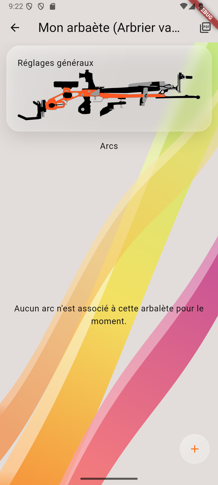 Aucun arc</td>
    <td align="center">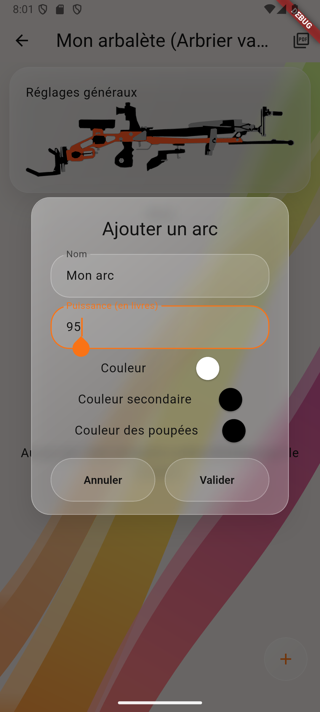 Ajout d'un arc</td>
    <td align="center">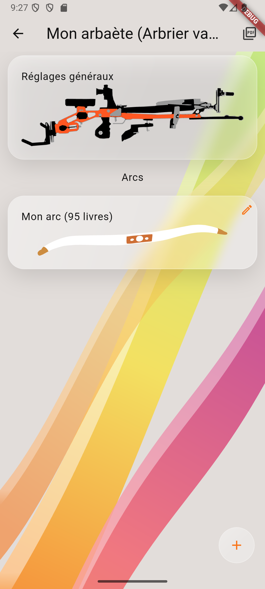 Arc ajouté</td>
  </tr>
</table>

### Réglages par défaut

Certains réglages sont créés automatiquement à l'ajout d'une arbalète ou d'un arc.

#### Réglages généraux

Ces réglages sont considérés comme fixes. Pour éviter de les noter pour chaque arc et chaque distance, ils sont regroupés dans une section dédiée. Par défaut, il s'agit de :

- la hauteur de busc ;
- la hauteur de crochet ;
- la hauteur de poignée avant.

<table align="center">
  <tr>
    <td align="center">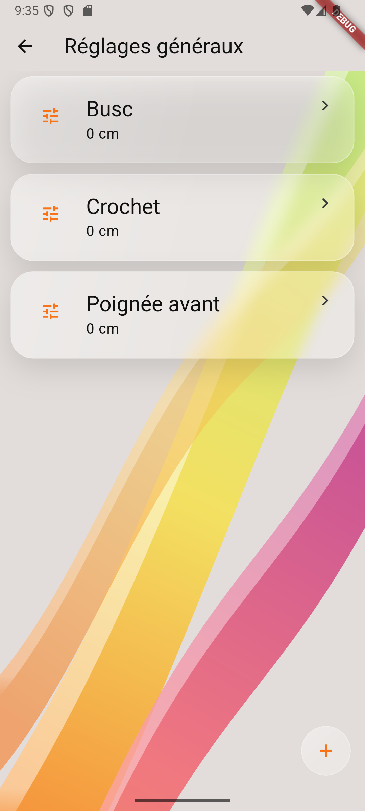 Réglages généraux</td>
  </tr>
</table>

#### Réglages par distance

Par défaut, un arc est créé avec des réglages pour les distances de 10, 18, 35, 50 et 65 mètres. Chacune d'elles comporte les réglages suivants :

- l'arbrier variable, si cela correspond au type de l'arbalète ;
- le dioptre, en hauteur et en latéral ;
- le viseur avant, en hauteur et en latéral.

<table align="center">
  <tr>
    <td align="center">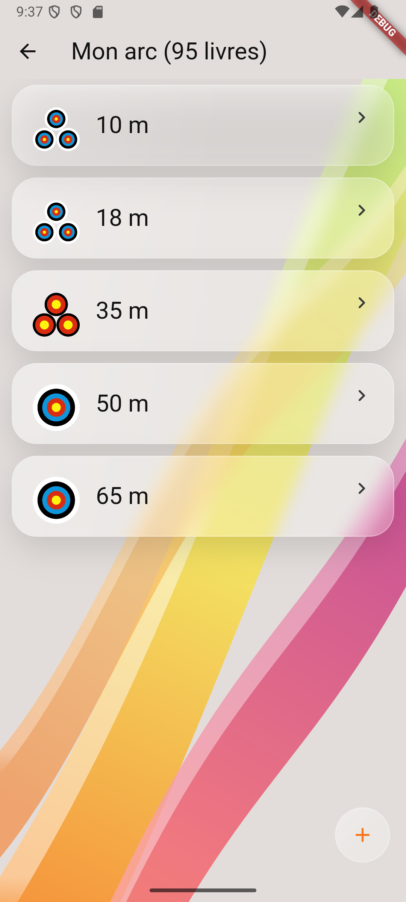 Distances d'un arc</td>
    <td align="center">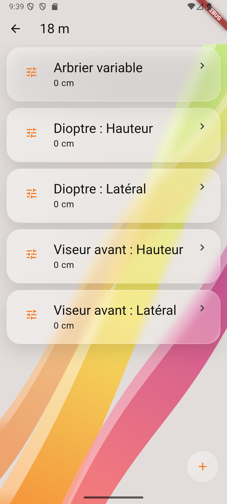 Réglages d'une distance</td>
  </tr>
</table>

### Ajouter un réglage

Si les réglages par défaut ne suffisent pas, il est possible d'ajouter un réglage général ou un réglage par distance à l'aide du bouton `+` en bas à droite.

Une fenêtre s'ouvre alors pour ajouter un ou plusieurs réglages. Dans cette fenêtre, le `+` permet d'ajouter un réglage supplémentaire et l'icône corbeille de retirer un réglage ajouté par erreur.

> [!TIP]
> Des pastilles sous le nom du réglage permettent de le pré-remplir avec des valeurs issues de réglages déjà existants pour d'autres arcs ou arbalètes.

<table align="center">
  <tr>
    <td align="center">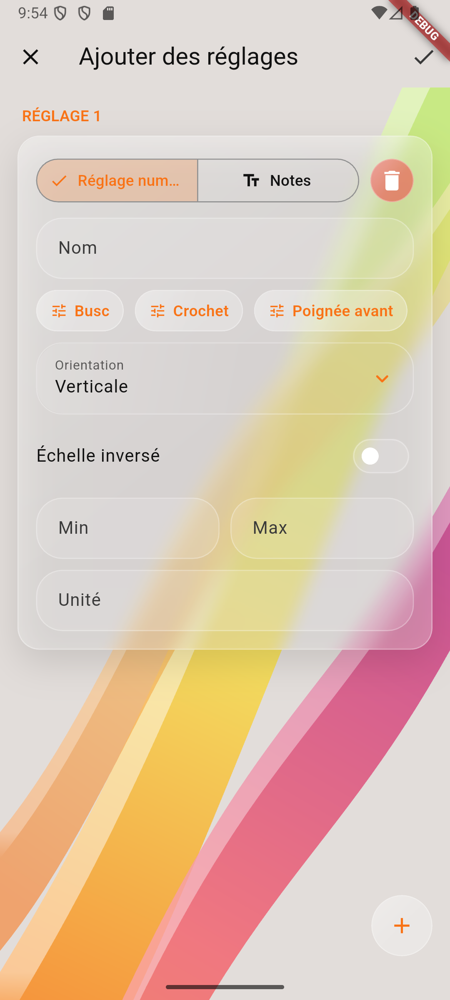 Ajout d'un réglage</td>
    <td align="center">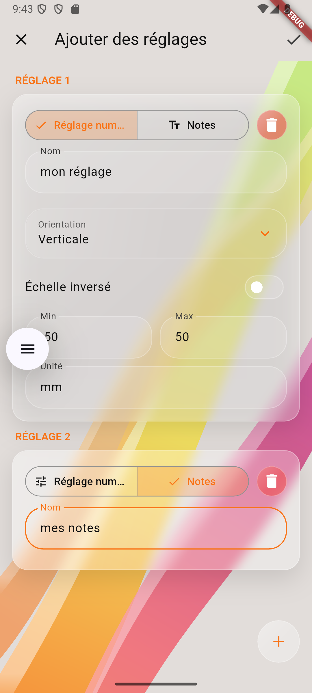 Ajout de plusieurs réglages</td>
  </tr>
</table>

#### Réglages numériques

Ces réglages sont gérés par des curseurs. Ils nécessitent les informations suivantes :

- un nom permettant de les identifier ;
- l'orientation du curseur, horizontale ou verticale ;
- un minimum et un maximum ;
- une unité (facultative).

Il est également possible d'inverser les graduations du curseur si nécessaire.

#### Notes

Des notes libres peuvent être ajoutées à côté des réglages. Il suffit de leur donner un titre.

### Consulter ou modifier un réglage

Un réglage créé peut être modifié en appuyant dessus.

#### Réglages numériques

Par défaut, les réglages numériques sont verrouillés pour éviter les appuis accidentels. Pour les modifier, appuyer sur le cadenas en haut à gauche de la barre d'outils, puis faire défiler le curseur. Pour un réglage plus fin, les boutons `-` et `+` sont disponibles. Les flèches situées à côté du cadenas permettent de défaire ou de refaire une action.

Les bornes et l'orientation du réglage sont modifiables via le stylo en bas à gauche.

<table align="center">
  <tr>
    <td align="center">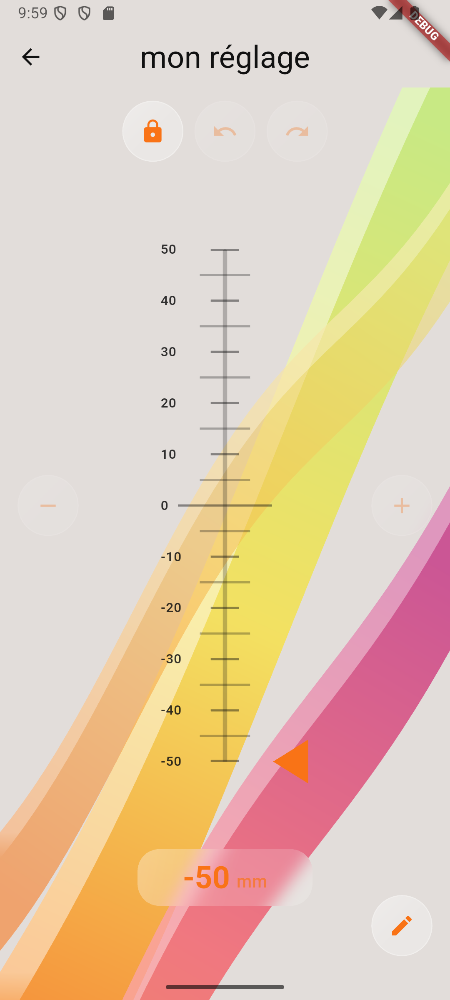 Réglage verrouillé</td>
    <td align="center"> Réglage déverrouillé</td>
  </tr>
</table>

#### Notes

Elles permettent de consigner des informations sous forme de texte.

<table align="center">
  <tr>
    <td align="center">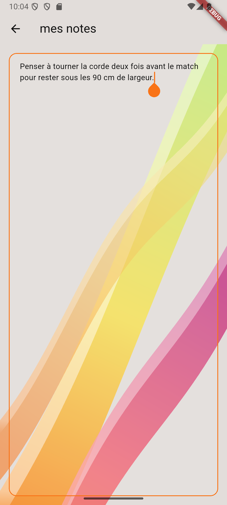 Note libre</td>
  </tr>
</table>

### Supprimer un réglage

Pour supprimer un réglage, effectuer un appui long dessus afin d'entrer en mode sélection. Une fois tous les réglages indésirables sélectionnés, appuyer sur la corbeille.

<table align="center">
  <tr>
    <td align="center">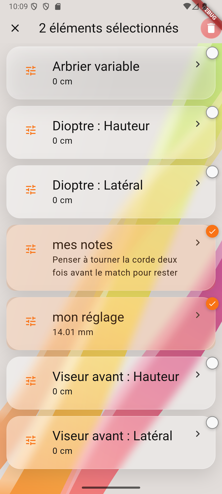 Sélection des réglages à supprimer</td>
  </tr>
</table>

### Exporter les réglages

Sur la page qui affiche les réglages généraux et la liste des arcs, le bouton **PDF** permet d'exporter les réglages dans ce format, ou de les imprimer.

<table align="center">
  <tr>
    <td align="center">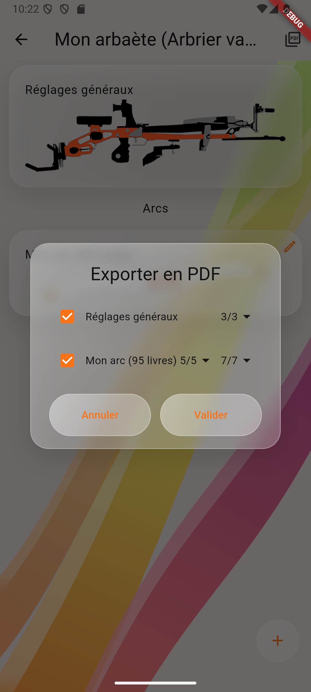 Bouton d'export PDF</td>
    <td align="center">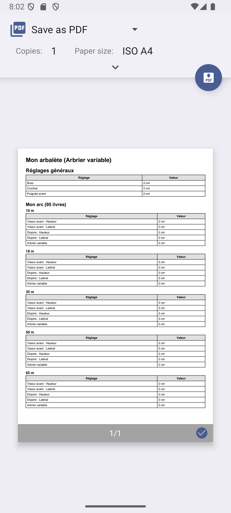 PDF des réglages</td>
  </tr>
</table>

[↑ Retour au sommaire](#sommaire)

---

## 3. Groupements de flèches

Cette fonctionnalité permet de regrouper des flèches en fonction de leur position moyenne.

### Ajouter un lot de flèches

Appuyer sur le `+` en bas à droite de l'onglet **Groupements de flèches** pour ajouter un lot de flèches, puis renseigner les champs suivants :

- le nom du lot ;
- la matière des flèches, aluminium ou carbone ;
- le diamètre, parmi des choix existants ou en saisissant un diamètre personnalisé ;
- la couleur des plumes ;
- les initiales, pré-remplies avec celles du premier tireur de la liste ;
- le numéro de la première flèche ;
- le nombre de flèches à ajouter.

<table align="center">
  <tr>
    <td align="center">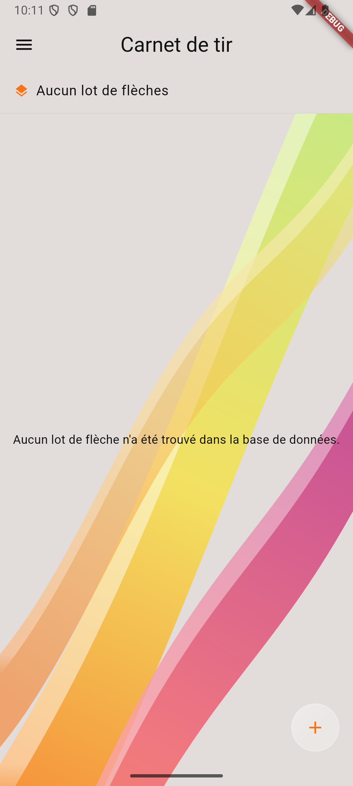 Aucun lot de flèches</td>
    <td align="center">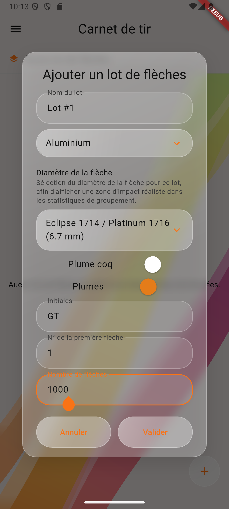 Ajout d'un lot</td>
    <td align="center">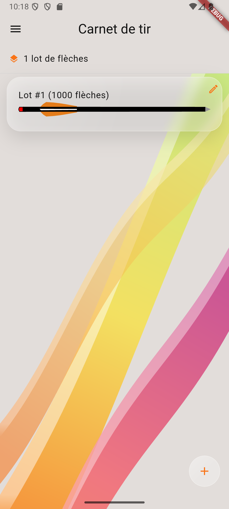 Lot ajouté</td>
  </tr>
</table>

Certaines de ces informations peuvent être modifiées par la suite grâce à l'icône en forme de stylo sur le lot de flèches.

### Saisir des impacts

Pour saisir des impacts, appuyer sur le lot de flèches concerné, puis choisir la distance afin d'afficher le blason adapté.

Appuyer ensuite sur la flèche concernée et passer en mode sélection. Un réticule permet de placer précisément l'impact : il suffit de maintenir le doigt appuyé et de le faire glisser.

Tous les impacts apparaissent en rose, et leur position moyenne en violet.

<table align="center">
  <tr>
    <td align="center">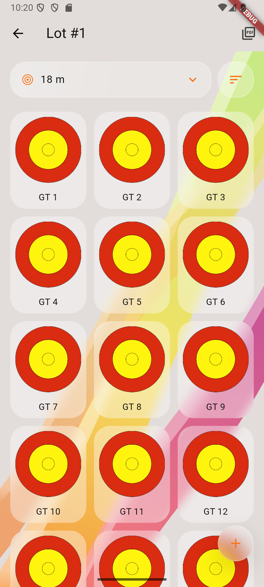 Flèches d'un lot</td>
    <td align="center">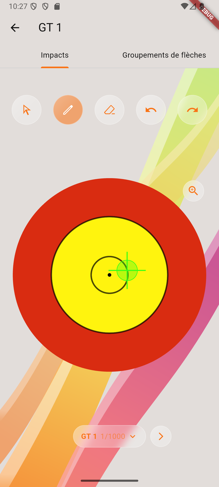 Placement avec le réticule</td>
    <td align="center">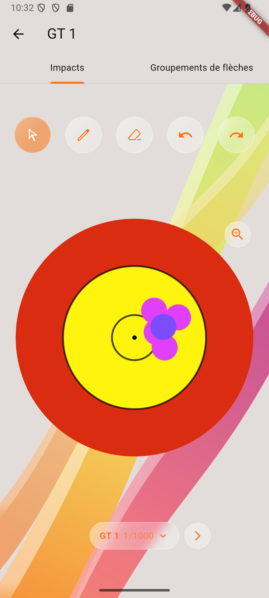 Impacts et position moyenne</td>
  </tr>
</table>

### Calculer des groupements

Dans l'onglet **Groupements de flèches**, il est possible de constituer des groupements autour d'une même flèche en définissant un écart maximal toléré entre chacune des flèches du groupe.

<table align="center">
  <tr>
    <td align="center">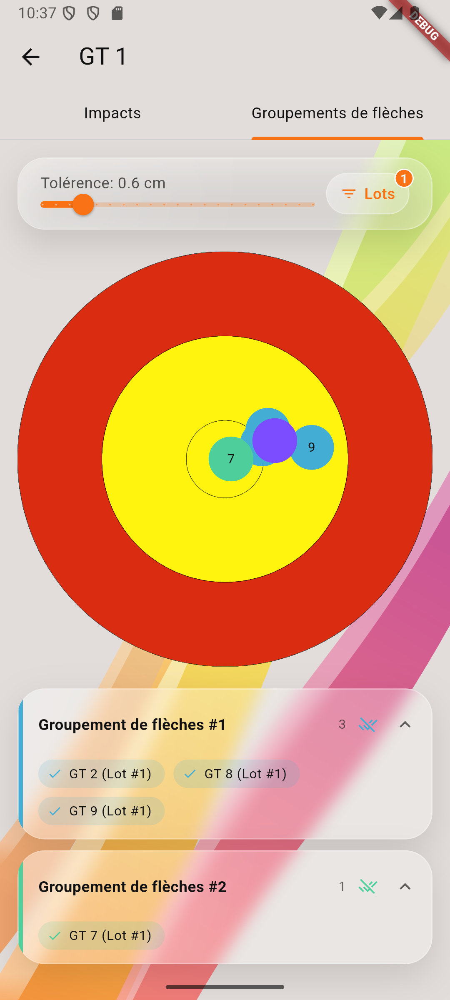 Groupements calculés</td>
  </tr>
</table>

### Ajouter ou supprimer des flèches

Des flèches peuvent être ajoutées individuellement ou par série à l'aide du bouton `+` en bas à droite de la grille.

Pour entrer en mode sélection, effectuer un appui prolongé sur une flèche. Il est ensuite possible de supprimer les flèches sélectionnées avec l'icône corbeille.

<table align="center">
  <tr>
    <td align="center">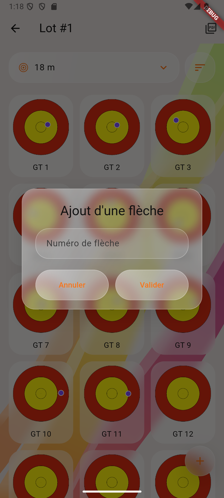 Ajout d'une flèche</td>
    <td align="center">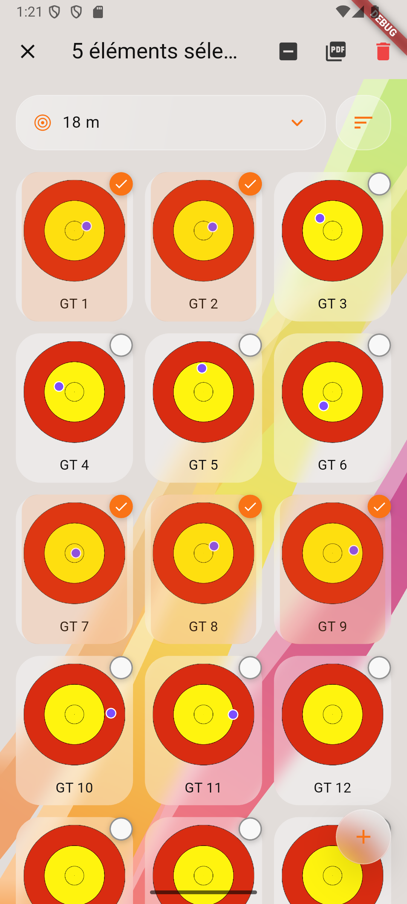 Suppression de flèches</td>
  </tr>
</table>

### Tri et export

Les flèches sont triables par nom, par date d'ajout ou par position de l'impact moyen, à l'aide du bouton de filtre.

Lors d'un export avec le bouton **PDF**, cet ordre est conservé, ce qui permet de repérer plus rapidement les flèches à regrouper.

<table align="center">
  <tr>
    <td align="center">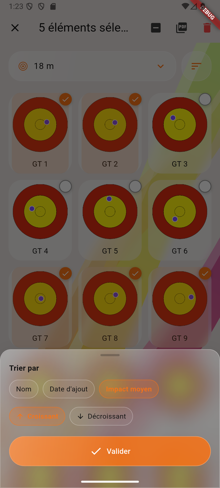 Menu de tri</td>
    <td align="center">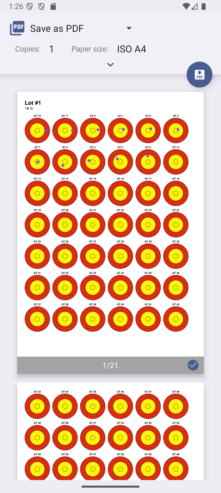 Export PDF</td>
  </tr>
</table>

[↑ Retour au sommaire](#sommaire)

---

## 4. Entraînement et cible interactive

La cible interactive permet de noter ses points d'entraînement.

> [!NOTE]
> Il faut avoir enregistré au moins un tireur pour utiliser cette fonctionnalité.

### Types de match

Les mêmes types de match sont proposés pour les entraînements avec cible et pour les résultats (voir [Résultats de matchs](#5-résultats-de-matchs)) :

| Type de match | Organisation |
| --- | --- |
| 10 m | 10 volées |
| 18 m | 10 volées |
| 18 m | deux séries de 10 volées |
| 35 m | 10 volées |
| 50 m | 10 volées |
| 65 m | 10 volées |
| IR 900 | trois séries de 5 volées |
| IR 900 | trois séries de 10 volées |

### Démarrer une séance

Se rendre sur la page **Feuilles de marque**, appuyer sur le bouton `+`, puis sélectionner **Ajouter un entraînement avec cible**. Renseigner ensuite le diamètre de la flèche, le tireur associé et le [type de match](#types-de-match).

<table align="center">
  <tr>
    <td align="center">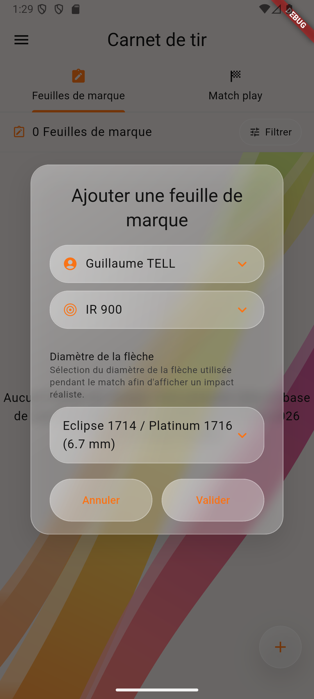 Ajout d'un entraînement IR 900</td>
    <td align="center">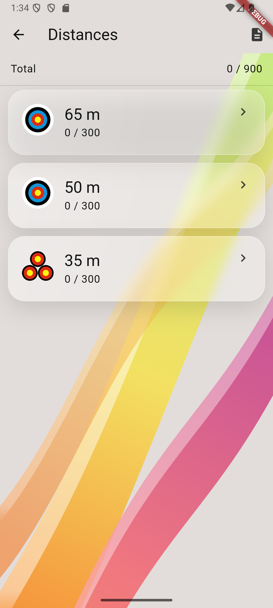 Séries d'un IR 900</td>
  </tr>
</table>

### Placer les impacts sur la cible

Les impacts se placent par volée de trois flèches. Chaque flèche se place à l'aide d'un appui long et peut être retirée avec l'outil **gomme**.

> [!TIP]
> L'appui long déclenche un zoom sur la cible pour une meilleure précision. Le niveau de zoom est paramétrable via le menu `⋮` (trois points verticaux).

Pour passer d'une volée à l'autre, utiliser les flèches directionnelles en bas de l'écran.

<table align="center">
  <tr>
    <td align="center">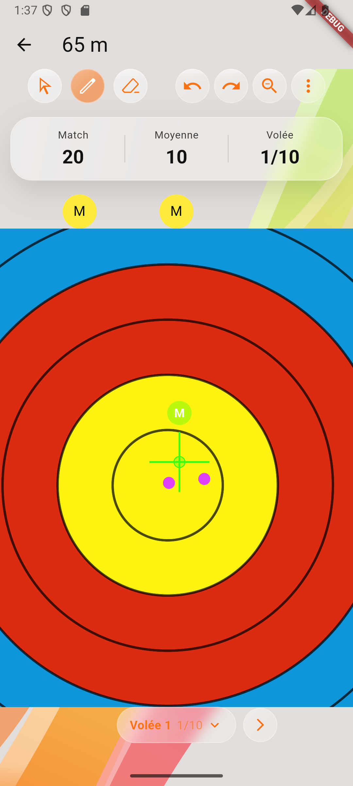 Volée à 65 m</td>
    <td align="center">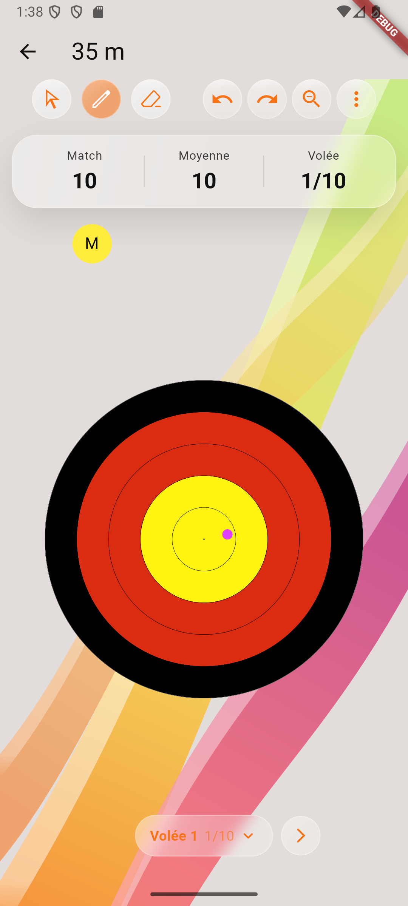 Volée à 35 m</td>
  </tr>
</table>

### Vue globale des impacts

Un bilan de tous les impacts d'une distance est accessible depuis n'importe quelle volée de cette distance, via le menu `⋮` → **Statistiques des flèches**.

<table align="center">
  <tr>
    <td align="center">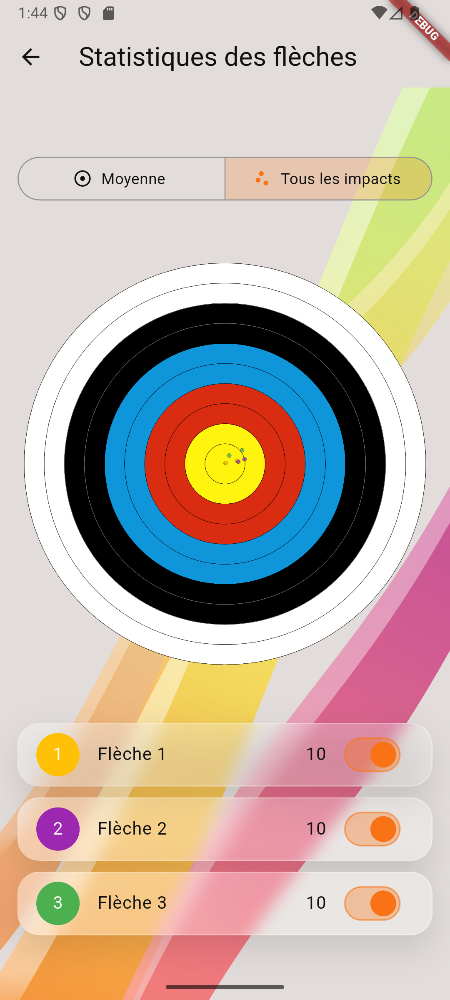 Statistiques des flèches</td>
  </tr>
</table>

### Chronomètre

Un chronomètre est également disponible pendant la saisie. Voir la section [Chronomètre](#7-chronomètre).

### Consulter et modifier les informations d'un match

Une vue plus globale du match s'obtient en appuyant sur le bouton en forme de feuille, sur la page qui affiche toutes les séries.

Elle comprend une grille avec toutes les volées, ainsi qu'un onglet d'informations dans lequel la date et le lieu sont configurables. Il est également possible d'y ajouter une **étiquette** préfixée d'un `#`, afin de pouvoir filtrer par la suite, ou des notes libres.

<table align="center">
  <tr>
    <td align="center"> Séries du match</td>
    <td align="center">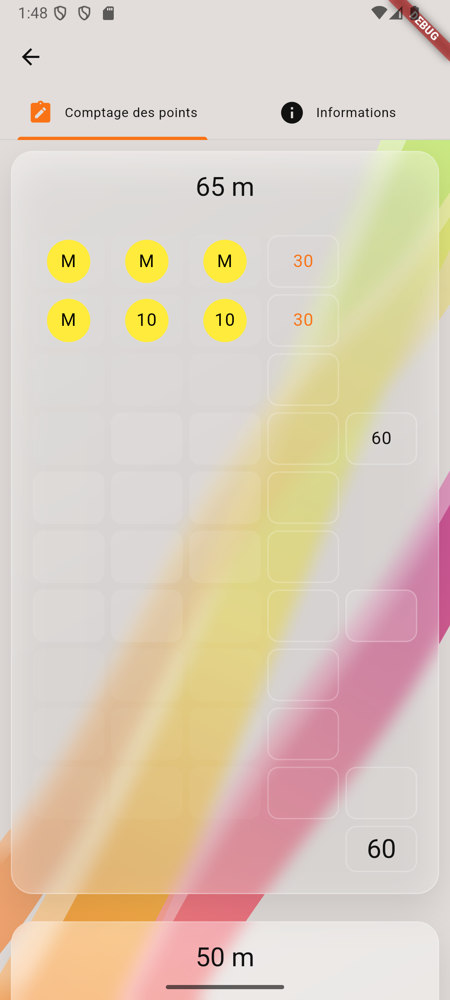 Grille des volées</td>
    <td align="center">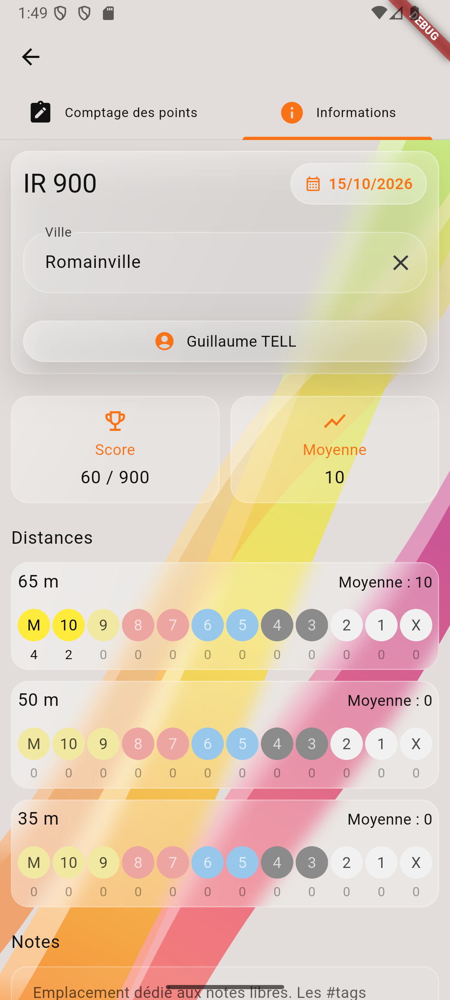 Informations du match</td>
  </tr>
</table>

[↑ Retour au sommaire](#sommaire)

---

## 5. Résultats de matchs

Cette section sert à consigner les résultats de ses matchs passés.

### Ajouter un match

Se rendre sur la page **Feuilles de marque**, appuyer sur le bouton `+`, puis sélectionner **Ajouter un résultat**. Renseigner ensuite le tireur associé et le [type de match](#types-de-match).

Le lieu, la date et le détail des séries peuvent également être renseignés.

<table align="center">
  <tr>
    <td align="center">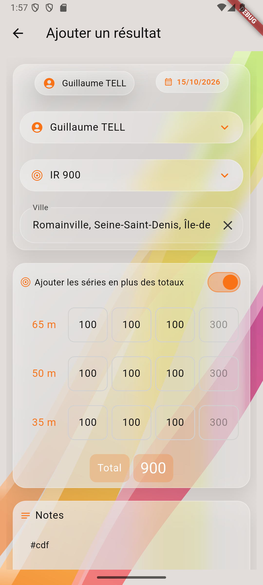 Ajout d'un résultat</td>
    <td align="center">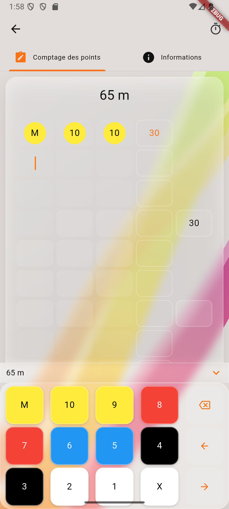 Saisie avec le clavier dédié</td>
  </tr>
</table>

> [!TIP]
> Une version en grille, avec un clavier dédié, est également disponible en sélectionnant **Ajouter une feuille de marque**.

### Filtrer les matchs

Tous les matchs restent accessibles, qu'il s'agisse des entraînements avec cible ou des résultats. Des filtres avancés permettent de les retrouver plus facilement : ils servent notamment à trier par score, à se restreindre à une plage de dates, ou à se limiter à certains tireurs, lieux ou étiquettes.

<table align="center">
  <tr>
    <td align="center">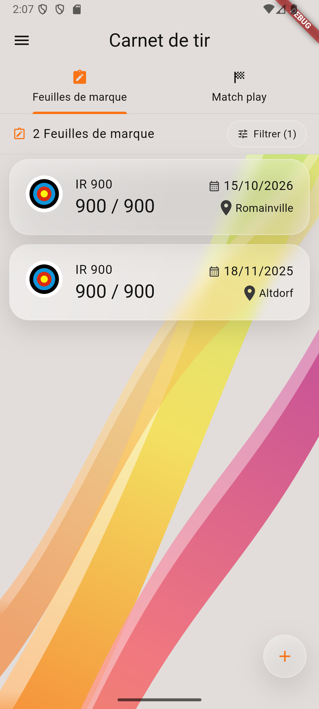 Liste des matchs</td>
    <td align="center">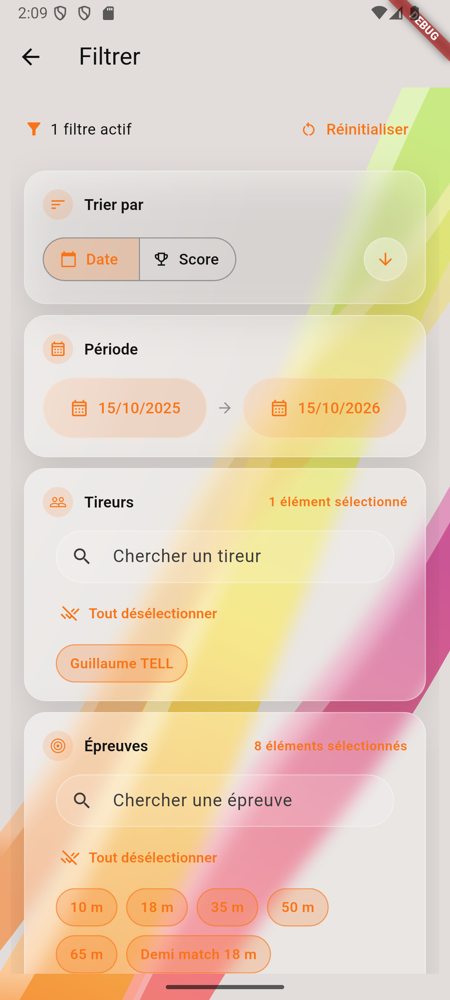 Filtres</td>
  </tr>
</table>

[↑ Retour au sommaire](#sommaire)

---

## 6. Match play

Des *match play* sont disponibles sur la page **Feuilles de marque**, dans l'onglet **Match play**. Ils nécessitent au moins deux tireurs enregistrés dans l'application. Une version à trois tireurs est également disponible.

Les règles suivantes s'appliquent :

- si un tireur obtient un meilleur score que son ou ses adversaires sur une volée, il gagne deux points ;
- en cas d'égalité de score entre plusieurs tireurs, un point est attribué à chacun d'eux ;
- le premier tireur à atteindre 5 points gagne, sauf en cas d'égalité : le match continue alors jusqu'à ce qu'un tireur ait un score strictement supérieur à celui de son ou ses adversaires.

<table align="center">
  <tr>
    <td align="center">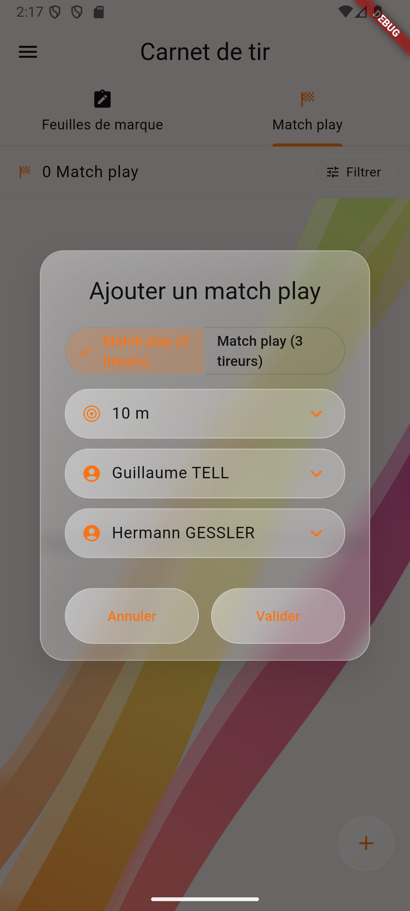 Création d'un match play</td>
    <td align="center">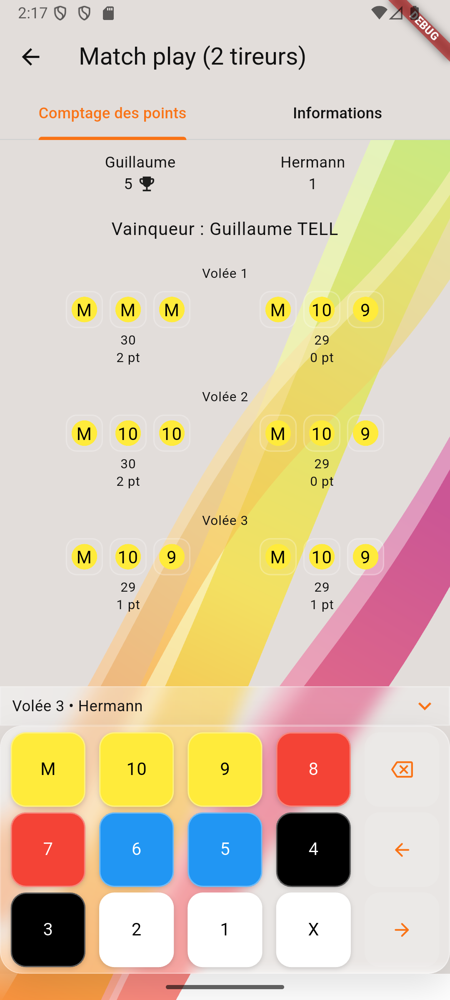 Match play en cours</td>
  </tr>
</table>

[↑ Retour au sommaire](#sommaire)

---

## 7. Chronomètre

Le chronomètre permet de mesurer le temps de tir.

### Utiliser le chronomètre

Il comprend les phases suivantes :

- un temps de préparation (20 secondes par défaut) ;
- un temps de tir (2 minutes par défaut à 18 m, 3 minutes pour les autres distances) ;
- un avertissement lorsqu'il ne reste que 30 secondes.

Les temps de préparation et de tir sont configurables pour chaque distance. Un signal sonore retentit à chaque phase ; il peut être désactivé en appuyant sur l'icône en forme de haut-parleur.

<table align="center">
  <tr>
    <td align="center">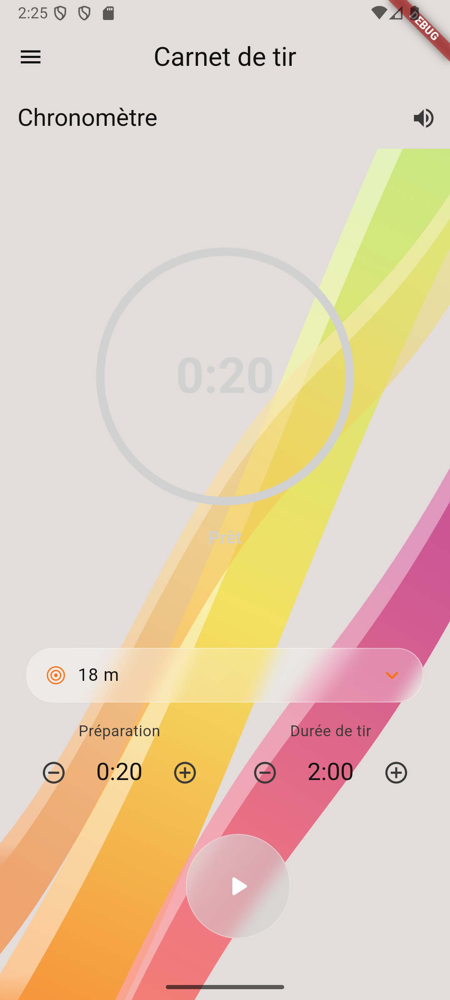 Chronomètre à l'arrêt</td>
    <td align="center">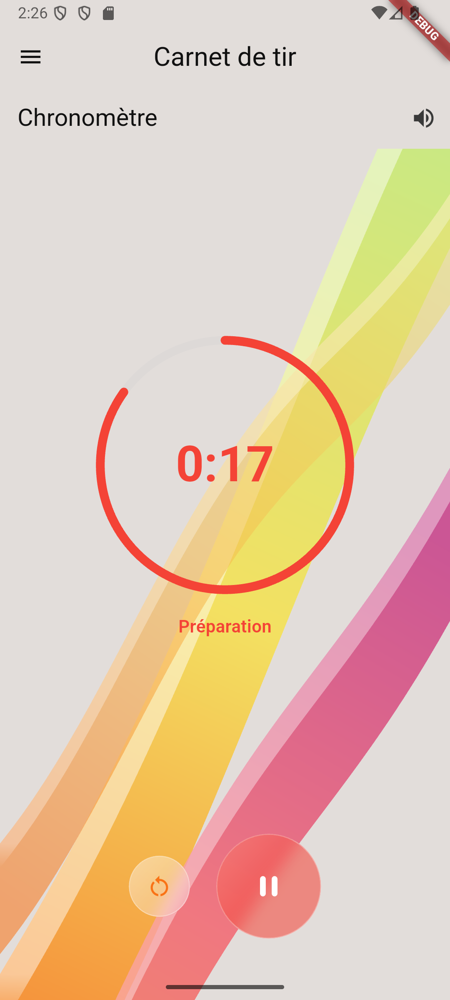 Phase de préparation</td>
  </tr>
  <tr>
    <td align="center">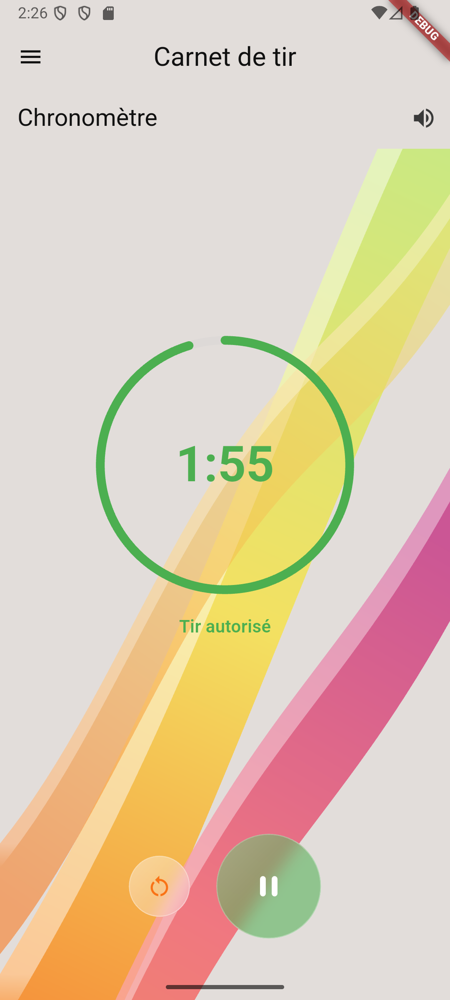 Phase de tir</td>
    <td align="center">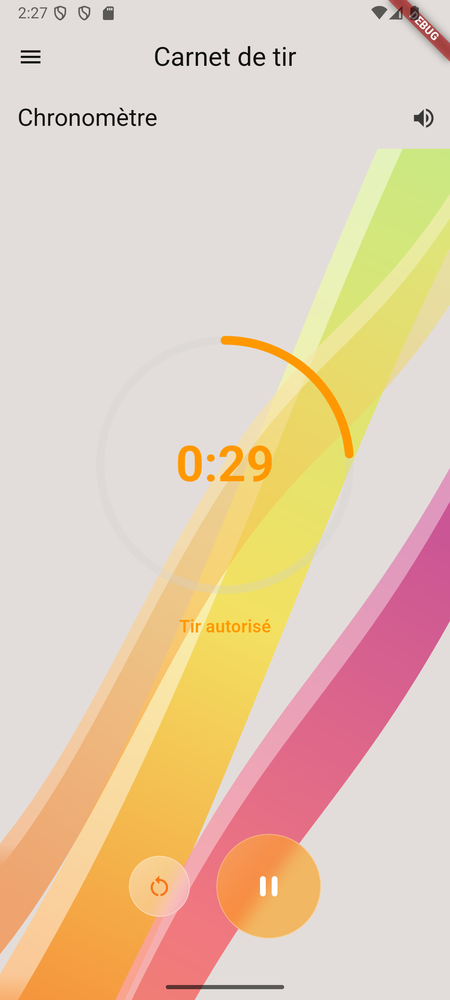 Avertissement (30 secondes restantes)</td>
  </tr>
</table>

[↑ Retour au sommaire](#sommaire)

---

## 8. Statistiques

Cette section permet de visualiser la progression de ses scores dans le temps. On y retrouve les mêmes filtres que pour la liste des matchs.

Un graphique représente les scores en fonction du temps, tandis qu'un diagramme en bâtons représente la moyenne des scores selon les filtres appliqués.

<table align="center">
  <tr>
    <td align="center">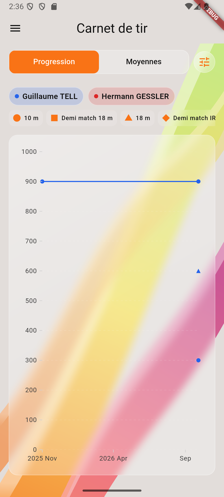 Évolution des scores</td>
    <td align="center">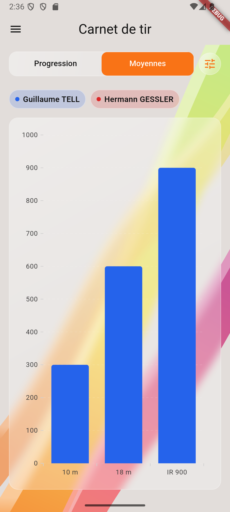 Moyenne des scores</td>
  </tr>
</table>

[↑ Retour au sommaire](#sommaire)

---

## 9. Licence FFTir

Cette fonctionnalité donne un accès rapide à sa licence FFTir. Pour cela, il faut l'importer au format PDF, ou la récupérer directement depuis *Eden* dans l'application en sélectionnant l'option **Télécharger au format badge**.

Il est possible d'ajouter une licence par tireur.

<table align="center">
  <tr>
    <td align="center">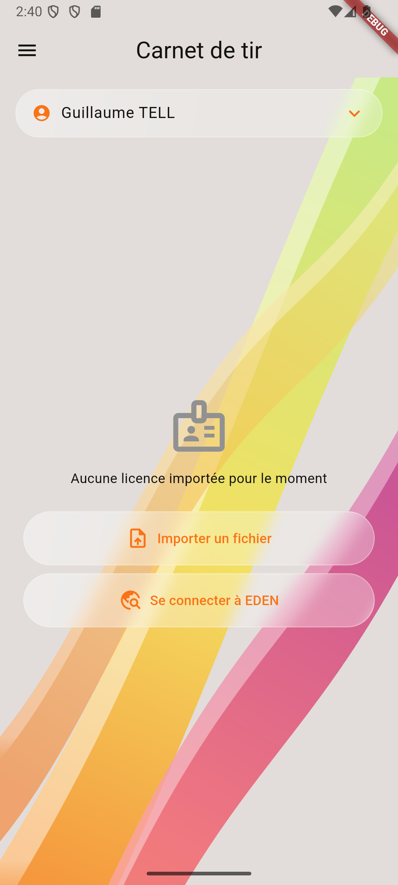 Licence FFTir</td>
  </tr>
</table>

[↑ Retour au sommaire](#sommaire)

---

## 10. Calendrier et rappels

Le calendrier sert à planifier ses prochains matchs, qu'il s'agisse d'une compétition ou d'un entraînement, et à être prévenu par une notification avant la date. Il est accessible depuis le tiroir de navigation.

### Consulter le calendrier

Les jours qui comportent au moins un match sont marqués d'un point. Une petite cloche à côté du point indique qu'au moins un rappel est programmé ce jour-là.

Appuyer sur un jour affiche les matchs correspondants sous le calendrier, avec le même affichage que dans la page **Feuilles de marque**.

<table align="center">
  <tr>
    <td align="center"> Calendrier sans évènement</td>
    <td align="center"> Évènement planifié</td>
  </tr>
</table>

### Planifier un évènement

Appuyer sur le bouton `+`, puis renseigner :

- le **type de saisie** : **Feuille de marque**, **Résultat** ou **Cible interactive**, selon la façon dont le match sera complété ;
- le **type de match** et le **tireur** associé ;
- la **date**, et éventuellement l'**heure de début** ;
- des **notes**, qui peuvent contenir des étiquettes, par exemple pour signaler une compétition ;
- les **rappels** souhaités.

Valider crée un match vide à la date choisie. Le jour venu, il suffit de l'ouvrir, depuis le calendrier ou depuis la page **Feuilles de marque**, pour saisir les tirs ou les résultats.

<table align="center">
  <tr>
    <td align="center"> Planification d'un évènement</td>
  </tr>
</table>

> [!NOTE]
> Il faut avoir enregistré au moins un tireur pour planifier un évènement.

> [!NOTE]
> Le match planifié apparaît dans la liste des matchs dès sa création, comme n'importe quel autre match.

### Les rappels

Un rappel est une notification envoyée un certain nombre de jours avant le match : le jour même (**Jour J**), ou **J-1**, **J-2**, **J-3**, **J-7** et **J-14**. Plusieurs rappels peuvent être combinés pour un même match.

La notification indique le type de match, le délai restant, l'heure de début, le lieu et la première ligne des notes.

Les rappels sont envoyés à l'heure définie dans les paramètres. Lorsqu'une heure de début est renseignée, le rappel du jour J est avancé à une heure avant le début du match si l'heure d'envoi serait trop tardive.

> [!IMPORTANT]
> Sur Android 13 et versions suivantes, ainsi que sur iOS, l'application demande l'autorisation d'envoyer des notifications. Sans cette autorisation, aucun rappel n'est reçu. Elle peut être accordée à tout moment dans les réglages du téléphone.

### Modifier ou supprimer un évènement

Appuyer sur la pastille de rappels située au-dessus d'un match ouvre une feuille qui permet de :

- modifier la **date** et l'**heure** (la croix retire l'heure), le **lieu** et les **notes** ;
- choisir les **rappels** ;
- **Supprimer les rappels** : le match est conservé, seules les notifications disparaissent ;
- **Supprimer le match** : après confirmation, le match et ses rappels sont supprimés.

Les matchs à venir qui n'ont aucun rappel affichent une pastille **Ajouter un rappel**. Les matchs créés avant l'arrivée du calendrier peuvent ainsi, eux aussi, être rappelés.

> [!TIP]
> Supprimer un match depuis la page **Feuilles de marque** supprime également ses rappels.

### Régler les rappels

Dans la page **Paramètres**, la section **Calendrier** permet d'activer ou de désactiver tous les rappels, de choisir l'heure d'envoi, et de définir les rappels proposés par défaut aux nouveaux évènements.

Modifier ces valeurs n'a pas d'effet sur les évènements déjà créés : chacun conserve ses propres rappels.

<table align="center">
  <tr>
    <td align="center"> Paramètres des rappels</td>
  </tr>
</table>

[↑ Retour au sommaire](#sommaire)

---

## 11. Paramètres

### Thèmes

De nombreux thèmes, clairs ou foncés, sont disponibles pour personnaliser l'application. Ils se choisissent dans la page **Paramètres**.

<table align="center">
  <tr>
    <td align="center"> Thème vert</td>
    <td align="center"> Thème violet</td>
  </tr>
</table>

### Gestion des données

Dans les paramètres, il est possible d'importer ou d'exporter ses données au format JSON. Il suffit pour cela de se rendre dans **Gérer mes données**.

Les données peuvent également être synchronisées via Dropbox, en s'y connectant depuis ce même menu. La synchronisation automatique met alors les données à jour au démarrage de l'application, lorsqu'elle est mise en pause, ou périodiquement.

<table align="center">
  <tr>
    <td align="center"> Import et export des données</td>
  </tr>
</table>

[↑ Retour au sommaire](#sommaire)

---

## 12. Signaler un problème

Pour signaler un bug ou proposer une amélioration, ouvrir une *issue* [sur le dépôt GitHub](https://github.com/vd99/carnet_de_tir_installation/issues), en vérifiant au préalable qu'une issue similaire n'existe pas déjà.